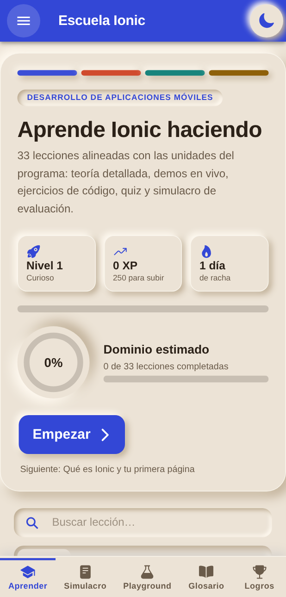
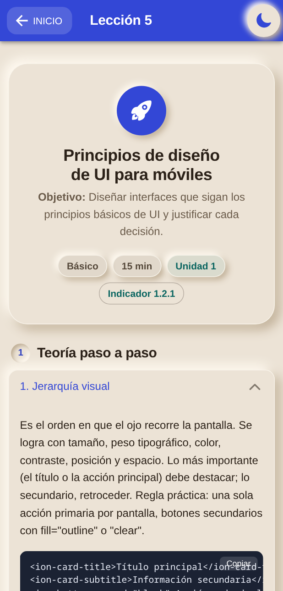
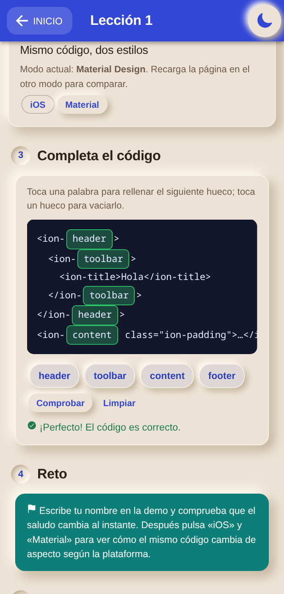
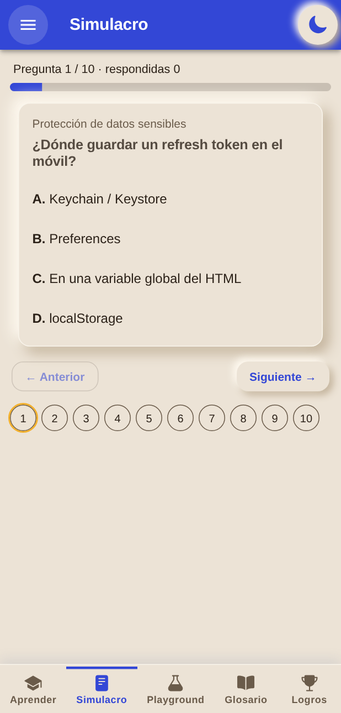
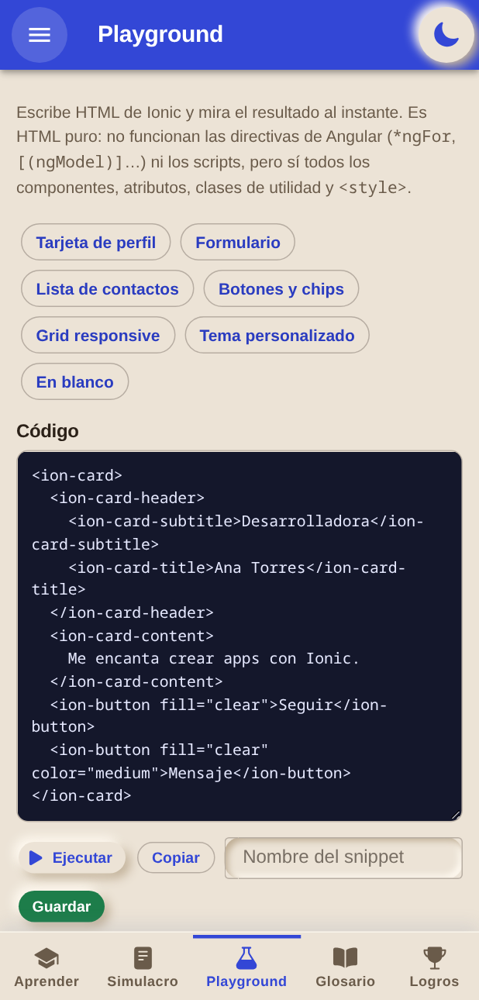
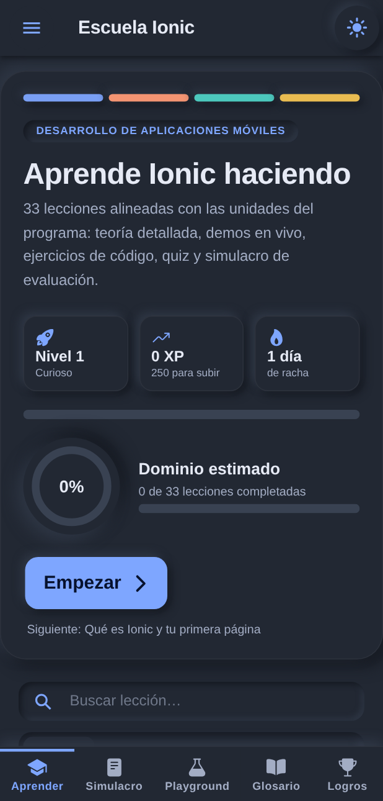

# Escuela Ionic

[](https://github.com/camilo-lavado/escuela-ionic/actions/workflows/ci.yml)


Curso interactivo de **Desarrollo de Aplicaciones Móviles** (Ionic + Angular + Capacitor), organizado según el programa de la asignatura IF303CIINF. Funciona en el navegador y como **app Android** (APK/AAB).

| Inicio | Lección | Ejercicio | Simulacro |
|:---:|:---:|:---:|:---:|
|  |  |  |  |

| Playground | Modo oscuro |
|:---:|:---:|
|  |  |

## Contenido

| Unidad | Peso | Contenido |
|---|---|---|
| 1 · Iniciando nuestro proyecto | 10 % | Arquitectura, patrones (MVC/DI), comparativa, principios de UI, componentes, UX y accesibilidad |
| 2 · Los recursos son muchos | 20 % | Cámara, GPS, sensores, permisos, pruebas de periféricos, APIs (integración, optimización, pruebas) |
| 3 · Es momento de explorar el mundo | 30 % | Emuladores, depuración, pruebas automatizadas, autenticación, datos sensibles, auditoría de seguridad |
| Evaluación final | 40 % | Publicación y guía del proyecto final + vídeo |

**33 lecciones**, cada una con teoría detallada, demo en vivo, ejercicio «completa el código», reto y quiz. Además: simulacro de evaluación (con tiempo, por unidad, con nota), Playground de HTML Ionic, glosario de componentes, XP/niveles/insignias, mapa de indicadores de logro (1.1.1 – 1.6.3) y **copia de seguridad del progreso** (exportar/importar JSON).

## Empezar

Requisitos: Node.js 22 o superior y npm.

```bash
npm install
npm start            # http://localhost:4200  (o: npx ionic serve → :8100)
```

## Scripts

| Comando | Qué hace |
|---|---|
| `npm start` | Servidor de desarrollo |
| `npm run build` | Build de producción en `www/` |
| `npm run lint` | ESLint (`angular-eslint`) |
| `npx ng test --watch=false` | Pruebas unitarias (Vitest + jsdom) |
| `npm run e2e` | Pruebas de interfaz con Playwright (requiere `npm run build`) |
| `npm run apk` | APK de depuración de Android |
| `npm run apk:release` / `npm run aab` | APK release / App Bundle para Google Play (firmados si hay `keystore.properties`) |
| `npm run android:sync` · `android:open` · `assets` | Sincronizar con Capacitor · abrir Android Studio · generar iconos y pantalla de inicio |

## Pruebas y calidad

- **Unitarias (51):** integridad del temario, servicio de progreso, repositorio SQLite, utilidades, copia de seguridad.
- **e2e (59, Playwright):** recorren las 33 lecciones (demo, ejercicio, quiz, completar), el simulacro, Playground (incluido el saneado de HTML), glosario, buscadores, tema oscuro, persistencia, copia de seguridad y cámara. Fallan ante cualquier error de consola inesperado.
- **Accesibilidad:** [axe-core](https://github.com/dequelabs/axe-core) (WCAG 2.1 A/AA) sobre 7 pantallas en tema claro y oscuro; falla ante problemas *serious* o *critical*.

```bash
npm run build
npx playwright install chromium        # una vez (o PLAYWRIGHT_CHROMIUM_PATH=/usr/bin/chromium)
npm run e2e
```

CI (`.github/workflows/ci.yml`): lint, unitarias, build, e2e y APK de depuración en cada push y pull request. El registro de errores encontrados y corregidos está en **[PRUEBAS.md](PRUEBAS.md)**.

## App Android

La plataforma Android ya está añadida y sincronizada. Con Android Studio instalado: `npm run apk`. **Gradle 8.14 necesita Java 17–21** (el JBR de Android Studio reciente es Java 25): en Linux el script usa `/usr/lib/jvm/java-21-openjdk` si existe. En la app móvil las demos de cámara y GPS usan además `@capacitor/camera` y `@capacitor/geolocation`.

Guía completa —permisos, cambio de ID, **firma release, App Bundle, CI y publicación en Google Play**— en **[ANDROID.md](ANDROID.md)**.

## Estructura

```
src/app/
 ├─ app.config.ts · app.routes.ts · app.component.ts   (arranque standalone)
 └─ school/
     ├─ syllabus.ts          unidades, ponderaciones e indicadores del programa
     ├─ lessons*.ts          contenido de las lecciones (añade aquí nuevas lecciones)
     ├─ school.service.ts    progreso, XP, racha, insignias y copia de seguridad (signal `version`)
     ├─ progress-backup.ts   formato y validación de la copia de seguridad
     ├─ demos/               demos interactivas de cada lección
     └─ home · lesson · exam · playground · glossary-page · profile · fill
src/theme/               variables.scss (tokens) + neumorphism.scss (componentes)
e2e/                     pruebas Playwright (+ servidor estático de www/)
android/                 proyecto nativo (Capacitor) · scripts/ build-apk.mjs
```

Para añadir una lección: agrega el objeto en `lessons-u*.ts`, su unidad/indicadores en `META` (`syllabus.ts`), su posición en `ORDER` (`lessons.ts`) y, si tiene demo, un `@case` en `lesson-demo.component.html`. `lessons.spec.ts` valida la coherencia de los datos y el e2e recorre la lección nueva automáticamente.

## Notas técnicas

- **Standalone** (estilo recomendado por la documentación de Ionic v9): sin NgModules; cada componente declara sus `imports` (`IonHeader`, `IonButton`… desde `@ionic/angular`), `main.ts` usa `bootstrapApplication` con `app.config.ts` (`provideIonicAngular()`, `provideRouter`, `provideHttpClient`) y las rutas están en `app.routes.ts` con `loadComponent`. Los iconos se registran con `addIcons`. Las demos de cada lección se cargan bajo demanda con `@defer`.
- **Progreso en SQLite**: tablas `lessons_done`, `quiz_first_try`, `fills_done`, `badges`, `snippets`, `exam_attempts` y `settings`. Se accede mediante el patrón Repository (`progress.repository.ts` + `sqlite-progress.repository.ts`) sobre `@capacitor-community/sqlite`: SQLite nativo en Android/iOS y, en la web, SQL.js + `<jeep-sqlite>` guardando en IndexedDB (`sql-wasm.wasm` se copia a `/assets` desde `angular.json`; **debe coincidir con la versión de SQL.js que usa jeep-sqlite**, por eso `sql.js` está fijado en 1.11.0). Los datos antiguos de localStorage se importan una sola vez. Si SQLite no arranca, la app sigue funcionando en memoria y lo avisa en «Logros». En la web el guardado en IndexedDB se agrupa (≈250 ms).
- **Copia de seguridad**: JSON versionado (`app`, `version`, listas de ids y ajustes). Al importar se valida y se normaliza todo (ids desconocidos descartados, números acotados, límite de tamaño) y se **reemplaza** el progreso; los simulacros se importan resumidos (un intento «importado» con la mejor nota).
- **Playground seguro**: el HTML del usuario se analiza en un `<template>` inerte y se eliminan `<script>`, `iframe`/`object`/`embed`, manejadores `on*` y URLs `javascript:` antes de mostrarlo (`playground/sanitize-html.ts`).
- **Iconos**: [Ionicons](https://ionic.io/ionicons). Cada icono se registra en `src/app/icons.ts` (solo se empaqueta lo que se registra) y se usa con `<ion-icon name="checkmark-circle" aria-hidden="true">` (decorativos; si el icono es el único contenido de un botón, el botón lleva `aria-label`). No hay emojis en la interfaz.
- **Angular 22**: componentes OnPush y sin zone.js. En las demos, el estado asíncrono se actualiza con `signal` o `markForCheck()`.
- **Tema**: Neumorphism / Soft UI (designmd.app). Claro = papel cálido con barra ultramar y un color por unidad; oscuro = gris azulado. Sin negro puro, contraste AA, `prefers-reduced-motion` respetado.
- **Cámara, GPS y sensores**: en el navegador usan las APIs web; en la app móvil se añade el camino nativo con los plugins de Capacitor.
- **Saltos de línea**: parte del código del proyecto usa CRLF; respeta el estilo del archivo que edites (`git ls-files --eol`).
